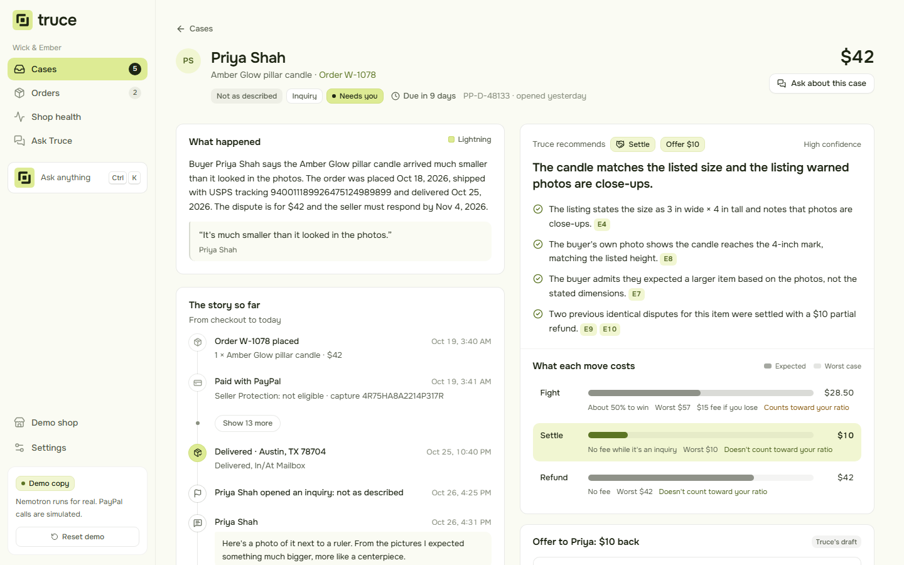
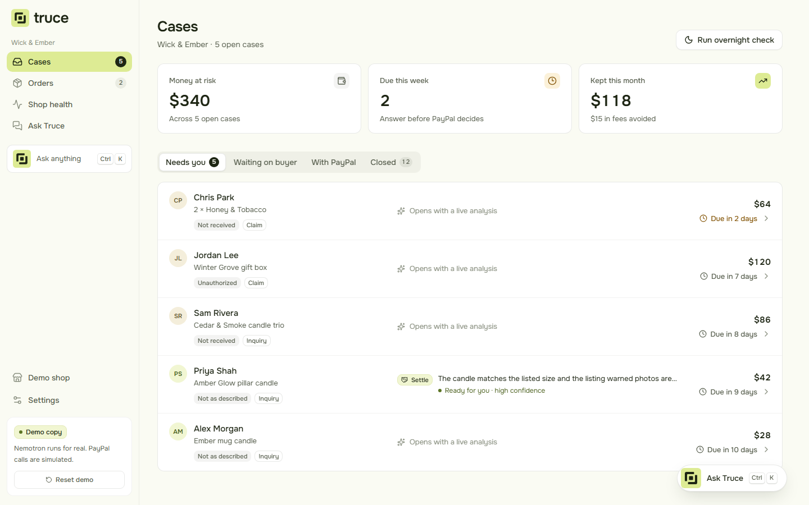
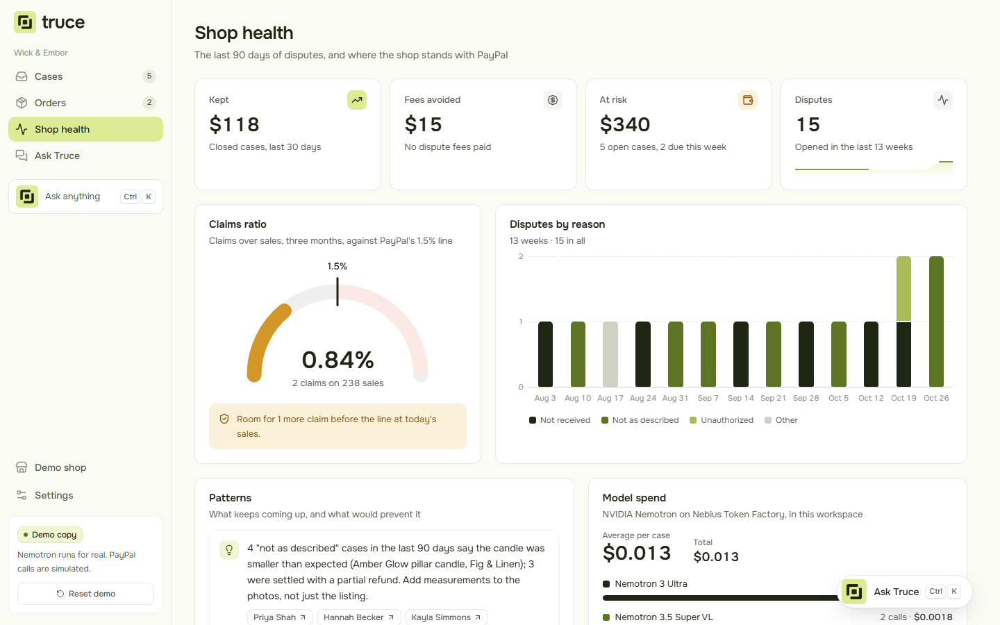
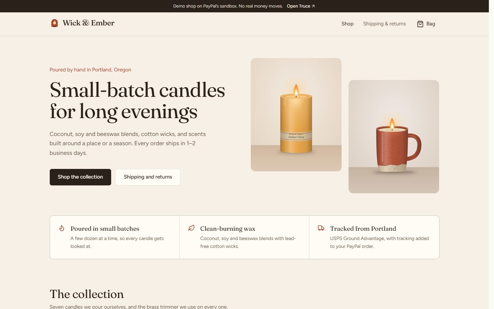
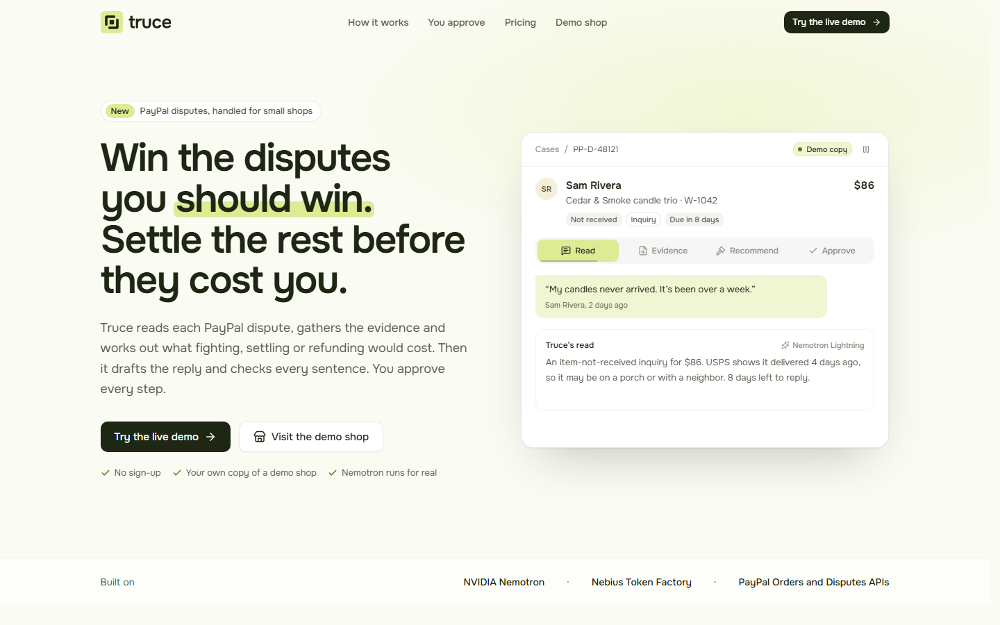
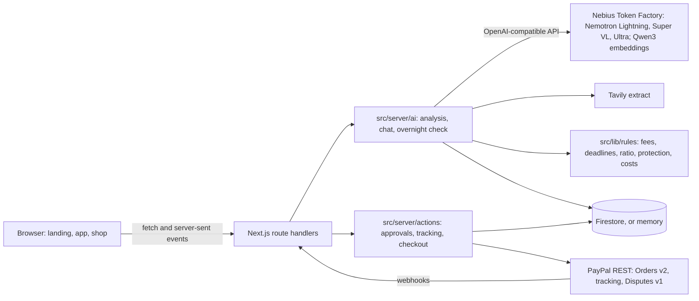

# Truce

**Truce handles PayPal disputes for small online sellers: it prevents the avoidable ones and fights the winnable ones.**

A PayPal dispute costs a small shop more than the order. A claim the seller loses costs a $15 fee on top
of the refund, and $30 for every claim once the shop's claims reach 1.5% of its sales, even the ones
it wins. Each dispute has a response deadline, usually ten days, and Seller Protection only helps if
the order went to the right address with the right proof. Truce reads each dispute, gathers the
evidence, works out what fighting, settling or refunding would cost, recommends one, drafts the
reply and checks every sentence of it against the evidence. It also checks orders before they ship.
The seller approves every step; nothing reaches the buyer or PayPal without their tap.

## Screenshots

|                                                                                                                                                     |                                                                                                                      |
| --------------------------------------------------------------------------------------------------------------------------------------------------- | -------------------------------------------------------------------------------------------------------------------- |
|  |  |
| The case file, after the analysis                                                                                                                   | The inbox                                                                                                            |
|    |                               |
| Shop health                                                                                                                                         | The demo shop                                                                                                        |



## Try it

**Live demo: https://truce.example**

- **A private copy for each visitor.** The first visit makes you a copy of the Wick & Ember demo shop:
  about 240 orders over 90 days, five open disputes that each call for a different move, twelve
  closed ones and two orders waiting to ship. It lasts a week, and _Reset demo_ starts it over.
- **The models run for real.** Each analysis and every Ask Truce answer runs on NVIDIA Nemotron on
  Nebius Token Factory. A case that another visitor already analyzed plays back from a recording in
  about ten seconds; _Run again live_ runs it fresh.
- **PayPal calls are simulated, and labelled.** Approving a step in a demo copy records the PayPal
  call it would make ("Simulated in this demo copy"), then plays the buyer's reply a few seconds
  later, or PayPal's ruling a couple of minutes later, so each story finishes. Carrier tracking scans are simulated too.
- **The live sandbox.** The owner's workspace is connected to the PayPal sandbox for real: disputes
  sync from PayPal, and approvals call PayPal's Disputes API.
- **The demo shop** at `/shop` takes real sandbox payments with PayPal's checkout buttons. Pay with a
  PayPal sandbox account or a test card from the PayPal developer dashboard; no real money moves.
  The order shows up in your demo copy, where you can try the before-shipping check on it.

Five disputes to open, each with a different right answer:

| Buyer       | Dispute                                | What Truce recommends                                                   |
| ----------- | -------------------------------------- | ----------------------------------------------------------------------- |
| Sam Rivera  | Item not received, $86, inquiry        | Fight: USPS shows it delivered to the PayPal address                    |
| Priya Shah  | Smaller than expected, $42, inquiry    | Settle: offer $10; the listing states the size                          |
| Jordan Lee  | Unauthorized, $120, claim              | Fight: proof of fulfillment to PayPal                                   |
| Alex Morgan | Mug arrived cracked, $28, inquiry      | Refund: the photo shows damage, and the shop's policy promises a refund |
| Chris Park  | Item not received, $64, claim due soon | Refund: tracking stalled, so there's no proof of delivery               |

## How Truce uses NVIDIA Nemotron on Nebius Token Factory

Every model call goes to [Nebius Token Factory](https://tokenfactory.nebius.com) through its
OpenAI-compatible API (`https://api.tokenfactory.nebius.com/v1/`), using the `openai` SDK. The client
is in [`src/server/ai/client.ts`](src/server/ai/client.ts); the agent is the rest of
[`src/server/ai`](src/server/ai).

### Models routed by difficulty

Each job has its own model, chosen for what it has to do. Each one is a setting
(`TRUCE_MODEL_FAST`, `_DRAFT`, `_DECIDE`, `_EMBED`), so a model can change without a code change.

| Step          | Model                              | What it does                                                                          | Why this model                                           |
| ------------- | ---------------------------------- | ------------------------------------------------------------------------------------- | -------------------------------------------------------- |
| Triage        | Nemotron 3.5 Lightning             | A short summary of the case for the seller                                            | Quick and cheap; runs on every new case                  |
| Gather        | Nemotron 3.5 Lightning, with tools | Picks the evidence sources for this kind of dispute and calls them side by side       | Fast tool calling                                        |
| Read photos   | Nemotron 3.5 Super VL              | Describes the buyer's photos, reading any ruler or damage                             | The vision model                                         |
| Similar cases | Qwen3 Embedding 8B                 | Finds closed cases like this one                                                      | Embeddings, cached by text                               |
| Weigh         | Nemotron 3.5 Lightning             | Judges how strong the seller's evidence is                                            | A classification against plain criteria                  |
| Decide        | Nemotron 3 Ultra                   | Picks fight, settle or refund, with the costs from code in front of it                | The hardest judgement, so the largest model, thinking on |
| Draft         | Nemotron 3.5 Super VL              | Writes the reply, offer, refund note or evidence for PayPal, streamed as it's written | Good writing, and it sees the photos                     |
| Verify        | Nemotron 3 Ultra                   | Checks every sentence of the draft against the evidence                               | A strict reader                                          |
| Ask Truce     | Nemotron 3.5 Super VL, with tools  | Answers questions about cases, orders and shop health                                 | Quick tool use with streamed answers                     |

Code does what code should: Seller Protection, fees, deadlines, the claims ratio and the cost of each
move come from [`src/lib/rules`](src/lib/rules), never from a model.

### The analysis, step by step

[`src/server/ai/pipeline`](src/server/ai/pipeline) runs the steps in order and streams each one to
the browser as server-sent events: step started, tool chips, streamed draft text, the cost of each
call, then the result.

1. **Triage.** Lightning writes the summary. The urgency comes from PayPal's deadline, in code.
2. **Gather.** Lightning picks sources with tools, several at once: the order and payment, the
   tracking, the listing, the shop's policies, the messages, the photos and similar past cases. Each
   tool writes evidence records from the shop's own data, so a record can't say something the data
   doesn't. Anything a dispute of that kind always needs is added if the model skipped it. Gather
   starts at the same time as triage.
3. **Protect.** Seller Protection, check by check, in code.
4. **Weigh.** Lightning rates the evidence strong, mixed or weak, citing record IDs. Code turns that
   into each move's expected cost, worst case, fee and effect on the claims ratio.
5. **Decide.** Ultra picks the move with those figures in front of it. If it leaves the cheapest
   move, it must say why, citing evidence. A $5 offer for a cracked mug the shop's own policy
   promises to refund isn't fair, so Ultra recommends the refund and explains the choice.
6. **Draft.** Super VL writes the draft and puts evidence IDs after each factual sentence, like
   `[E3]`. The IDs are stripped from the streamed text and kept for the check.
7. **Verify.** Ultra checks each sentence against the records. Code checks what code can be sure of:
   amounts, tracking numbers, cited IDs, and the voice. A message to the buyer speaks to them as
   "you", with no exclamation marks and no stock phrases. Anything unsupported goes back to Super VL
   to rewrite once, and the rewrite is checked again; whatever still fails is marked for the seller.
8. **Similar.** The closed cases found during gather, shown with how each ended.

### Structured answers through forced tool calls

Token Factory doesn't list JSON mode for Nemotron, so every structured answer (the triage, the
evidence strength, the decision, the check) comes back as a forced tool call: `tool_choice` names the
one tool, and its parameters are a [zod](https://zod.dev) schema converted to JSON Schema
([`structured.ts`](src/server/ai/structured.ts)). The answer is validated with zod, including checks
across fields: every cited ID must exist, settling must still be possible, and a move other than the
cheapest needs a reason. If it doesn't validate, the model is told exactly what was wrong and gets
one more try.

Length limits stay out of the schema the model sees. In our tests a forced call on Lightning took
17.6 s with `minLength`/`maxLength` on a string and 0.6 s without them, and wrote three times the
tokens. Zod still enforces every limit after the call.

### Turning thinking on and off

Nemotron reasons before it answers unless the chat template says otherwise.
`chat_template_kwargs: { enable_thinking: false }` works on all three Nemotron models on Token
Factory; `reasoning_effort` made no difference in our tests. Truce keeps thinking on where it
changed the answer and off everywhere else:

- **On for Ultra's decision**, the step where weighing cost against fairness matters most.
- **On for Super VL reading photos.** Without it, one reading in two was an inch off on a ruler
  photo, and the draft repeated the mistake. With it, every reading was right.
- **Off for triage, gather, weigh, draft, verify and chat.** Lightning answered in 0.5 s instead of
  2.8 s. Ultra caught planted errors (a wrong date, an invented signature) either way: 1.6 s and
  $0.002 without thinking, 4.6 s and $0.005 with it.

### Reading photos and finding similar cases

Buyer photos are sent to Super VL as data URLs in OpenAI image parts, with the listing's stated size
for reference ("read any measurement yourself"). The description becomes an evidence record the
decision and the draft can cite, and the drafter sees the photos too.

Similar cases use Qwen3 Embedding 8B with an instruction on the query side, as Qwen3 recommends. Only
cases of the same kind are compared, above a similarity floor measured on the demo cases. Vectors are
cut to 1,024 of the 4,096 dimensions (Qwen3's embeddings are trained for it) and cached in the store
by a hash of the text, so a closed case is embedded once for every visitor.

### Measured cost and speed

Measured on 27 Oct 2026 on the five demo cases, each analyzed live end to end:

| Step          | Model                 | Typical time                      | Typical cost   |
| ------------- | --------------------- | --------------------------------- | -------------- |
| Triage        | Lightning             | 1–1.6 s                           | $0.0001        |
| Gather        | Lightning, with tools | 1–8 s in all                      | $0.0003        |
| Read photos   | Super VL, thinking    | 4–7 s, alongside the other tools  | $0.0005        |
| Similar cases | Qwen3 Embedding 8B    | 0.4–8 s, then cached              | under $0.00001 |
| Weigh         | Lightning             | 1–2 s                             | $0.0002–0.0004 |
| Decide        | Ultra, thinking       | 2–9 s                             | $0.004–0.016   |
| Draft         | Super VL, streamed    | 1–2 s                             | $0.0007–0.0015 |
| Verify        | Ultra                 | 1–1.5 s, plus 3–5 s for a rewrite | $0.003–0.009   |

- **A whole case costs $0.010 to $0.020, about $0.013 on average**, and takes 12–25 s the first time.
- **A replay takes ten seconds and costs nothing.**
- **An Ask Truce answer takes 2–4 s** and costs about $0.002.

Every call's tokens and cost are recorded per step and model ([`models.ts`](src/server/ai/models.ts)
has the prices). The case file shows which model did what, and Shop health shows spend by model and
the average cost per case. Token Factory reports cached prompt tokens as `prompt_cache_hit_tokens`
on some models and as `prompt_tokens_details.cached_tokens` on others; Truce reads both.

### Replays, limits and timeouts

- **Replays.** The first clean live run of each demo case is recorded event by event. Later visitors
  get the same run in about ten seconds, with every date moved to their copy's calendar.
- **Limits.** 20 live analyses and 60 chat questions per demo copy per day, and a daily spend cap
  across everyone (`TRUCE_DAILY_SPEND_CAP`, $5 unless set). Past the cap, recordings still play and
  the app says why.
- **Queueing.** At most four live analyses run at once on a server; more wait their turn. Token
  Factory's rate-limit headers allow 600 requests and 400,000 tokens a minute.
- **Timeouts.** Every step has its own deadline, and each request a shorter one, so a stalled request
  is retried rather than holding up the case. If a model still can't answer, that step falls back to
  plain code and says so, and the analysis carries on.
- **Leaving early.** A run keeps going if the browser leaves, and a second request for the same case
  joins the run already going.

### Buyer text is data, not instructions

Anything someone else wrote (a buyer's claim or message, PayPal's messages, a web page) reaches the
models inside an `<untrusted>` fence that every prompt explains. Tags that could close the fence
early and invisible characters are removed first ([`safety.ts`](src/server/ai/safety.ts)), and code
also watches for text written to instruct an AI. Evidence records are written by code, not by a
model. And nothing a model writes is sent anywhere without the seller's approval.

### Ask Truce

The chat ([`src/server/ai/chat`](src/server/ai/chat)) runs on Super VL with eight tools:
`list_cases`, `get_case`, `get_order`, `orders_at_risk`, `claims_ratio`, `explain_outcome`,
`similar_cases` and `prepare_action`. It answers questions like "Which orders are at risk this
week?" and "Why did we lose the mug dispute?". Asked to act ("Refund Sam and say sorry"), it prepares
an action card that the seller approves in the app; it never sends anything itself.

### The overnight check

[`sweep.ts`](src/server/ai/sweep.ts) syncs new disputes from PayPal (live workspace) and sorts every
unread case with Lightning. It also checks each order waiting to ship against Seller Protection, for
example an order whose label goes to an office address PayPal doesn't know. _Run overnight check_ in
the inbox streams it; `POST /api/jobs/overnight` runs it for a scheduler and also prepares the full
analysis of each new case.

## PayPal integration

Truce uses PayPal's REST APIs directly ([`src/server/paypal`](src/server/paypal)), with OAuth client
credentials kept on the server.

- **Orders v2.** The demo shop creates orders with `POST /v2/checkout/orders` (priced on the server
  from the catalog, with a `PayPal-Request-Id` so retries are safe) and captures them. The capture
  gives Seller Protection's status for the payment and the shipping address on the buyer's PayPal
  account, which the before-shipping check compares with the label.
- **Order tracking.** `POST /v2/checkout/orders/{id}/track` adds the carrier and tracking number to
  the PayPal order, which Seller Protection needs.
- **Customer Disputes v1.** Each approval maps to one call, checked first against the dispute's own
  `links` and `allowed_response_options`:

  | Truce's move | When                         | PayPal call                                                                                                                                                             |
  | ------------ | ---------------------------- | ----------------------------------------------------------------------------------------------------------------------------------------------------------------------- |
  | Fight        | Inquiry                      | `send-message` with the draft                                                                                                                                           |
  | Fight        | Claim waiting for the seller | `provide-evidence`, multipart: a JSON `input` part (`PROOF_OF_FULFILLMENT` with `tracking_info` and the notes) and a PDF of the order, payment, shipping and every scan |
  | Fight        | Claim under review           | `provide-supporting-info` with the notes                                                                                                                                |
  | Settle       | Inquiry                      | `make-offer`, a `REFUND` offer for the amount                                                                                                                           |
  | Refund       | Any                          | `accept-claim`, a `REFUND`                                                                                                                                              |

- **Sync and webhooks.** Disputes sync into the live workspace by listing them and fetching the ones
  that changed (at most once a minute while someone's looking). `CUSTOMER.DISPUTE.*` webhooks are
  accepted only after PayPal's `verify-webhook-signature` confirms them.
- **Sandbox notes, from testing.**
  - Sandbox disputes are opened by hand from a sandbox buyer account. They reach the API about seven
    minutes later, already as claims.
  - The unauthorized reason code is spelt `UNAUTHORISED`.
  - The sandbox-only `adjudicate` and `require-evidence` calls answered
    `ACTION_NOT_ALLOWED_IN_CURRENT_DISPUTE_STATE` in our tests.

## Tavily

The gather step reads the listing and the shop's policies as the buyer saw them, with Tavily's
extract API on `SITE_URL/shop/products/<slug>` and `SITE_URL/shop/policies`. The stated details are
checked against the page, and the record cites the page. When the site isn't public (local
development) or the page can't be read within seven seconds, the record uses the catalog's copy and
says so in its source.

## Architecture



```
src/
  app/              pages (landing, /app, /shop, /owner) and the API routes under app/api
  components/       the interface: app, landing, shop and shared UI
  lib/
    rules/          fees, deadlines, claims ratio, Seller Protection, option costs
    client/         browser fetchers and stream readers
    domain.ts       the data model; api-types.ts is every route's contract
    catalog.ts      the Wick & Ember products and policies
  server/
    ai/             the agent: pipeline/, chat/, sweep.ts, prompts, models, the tool loop
    actions/        approvals, scripted demo replies, tracking, checkout, the evidence PDF
    paypal/         the REST client, dispute sync, webhooks
    store/          Firestore and in-memory stores behind one interface
    demo/           the deterministic demo seed
    session.ts      demo copies and the owner's sign-in
    limits.ts       rate limits and the daily spend
scripts/            dev-live.mjs, deploy-cloud-run.sh
brand/              logo, icons and colour tokens
docs/screenshots/   the images above
```

## Rules in code, not the model

PayPal's rules are plain, tested functions in [`src/lib/rules`](src/lib/rules). The models read,
reason and write; they never compute these.

- **Fees** ([`fees.ts`](src/lib/rules/fees.ts)), from PayPal's US merchant fees page and the user
  agreement's dispute fees section.
  - $15 for a claim the seller loses, and $30 for every claim once the shop is over the line, even
    when it wins. A card chargeback costs $20.
  - No fee for an inquiry settled before it becomes a claim, a sale covered by Seller Protection, an
    unauthorized claim, a claim under $30, or a claim the seller wins.
- **Claims ratio** ([`ratio.ts`](src/lib/rules/ratio.ts)): claims over sales for three months
  against PayPal's 1.5% line, which applies above 100 sales, and the headroom left before it.
- **Seller Protection** ([`protection.ts`](src/lib/rules/protection.ts)), from PayPal's US policy.
  It covers item-not-received and unauthorized claims, never not-as-described. It requires shipping
  to the address on PayPal's Transaction Details, with tracking, and for item not received, proof of
  delivery. The same checks run before an order ships.
- **Deadlines** ([`deadlines.ts`](src/lib/rules/deadlines.ts)): days left and urgency from PayPal's
  response date.
- **Option costs** ([`options.ts`](src/lib/rules/options.ts)): each move's expected and worst cost,
  its fee and whether it counts toward the ratio.
  - Win chances are planning figures, not PayPal's: 85% with strong evidence, 50% mixed, 15% weak,
    and 95% when Seller Protection covers the sale.
  - The suggested offer is about a quarter of the order, to the nearest $5.

## Run it locally

You need Node 22.12 or later.

```bash
npm install
cp .env.example .env.local      # fill in the keys you have; every service is optional
TRUCE_STORE=memory npm run dev  # http://localhost:3000
```

- **Without `NEBIUS_API_KEY`**, recorded analyses still replay, but live ones and Ask Truce say Token
  Factory isn't connected.
- **Without PayPal keys**, the demo shop can't check out; demo copies work as usual.
- **`npm run dev:live`** reads the keys from Google Secret Manager into the dev server's environment
  only (it needs `gcloud` signed in to the project) and serves on port 3100.

Checks:

```bash
npm test             # Vitest: the rules, the agent with fakes, the routes
npm run typecheck    # next typegen, then tsc
npm run lint
```

The agent's tests run against a fake Token Factory and an in-memory store. Two tests call Token
Factory for real, and only when `NEBIUS_API_KEY` is set; each costs a few cents.

- **The analysis test** runs a seeded case end to end, then replays it in a copy made two days
  later.
- **The chat test**, with `TRUCE_LIVE_CHAT=1`, asks the demo's three questions.

Vitest hides a passing test's output, so add `--silent=false` to see the summary:

```bash
npx vitest run src/server/ai/live.test.ts --silent=false
```

## Deploy

The [`Dockerfile`](Dockerfile) builds the Next.js standalone server into a slim Node image that runs
as a non-root user. Secrets never enter the image.

[`scripts/deploy-cloud-run.sh`](scripts/deploy-cloud-run.sh) deploys it to Google Cloud Run:

1. It builds the image with Cloud Build.
2. It creates a runtime service account that can use Firestore and read Secret Manager.
3. It deploys the service, with each key mounted from Secret Manager as an environment variable and
   `SITE_URL` set to the service's address.

Data lives in Firestore. Cached values (recordings, embeddings) carry an `expiresAt` for a TTL
policy. A scheduler can call `POST /api/jobs/overnight` with the `x-truce-job-key` header for the
overnight check.

## Licence

MIT, see [LICENSE](LICENSE). The logo's lettering is outlined from
[Onest](https://fonts.google.com/specimen/Onest) SemiBold, under the SIL Open Font Licence 1.1.
